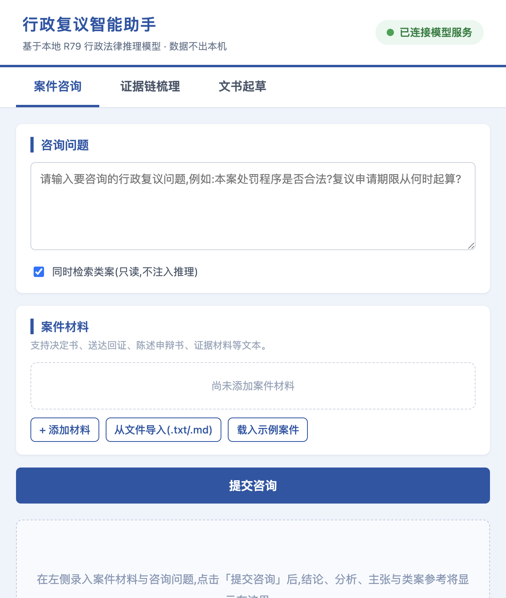
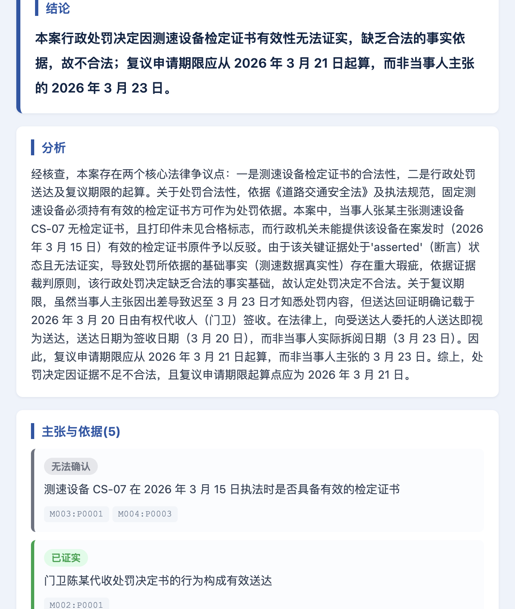
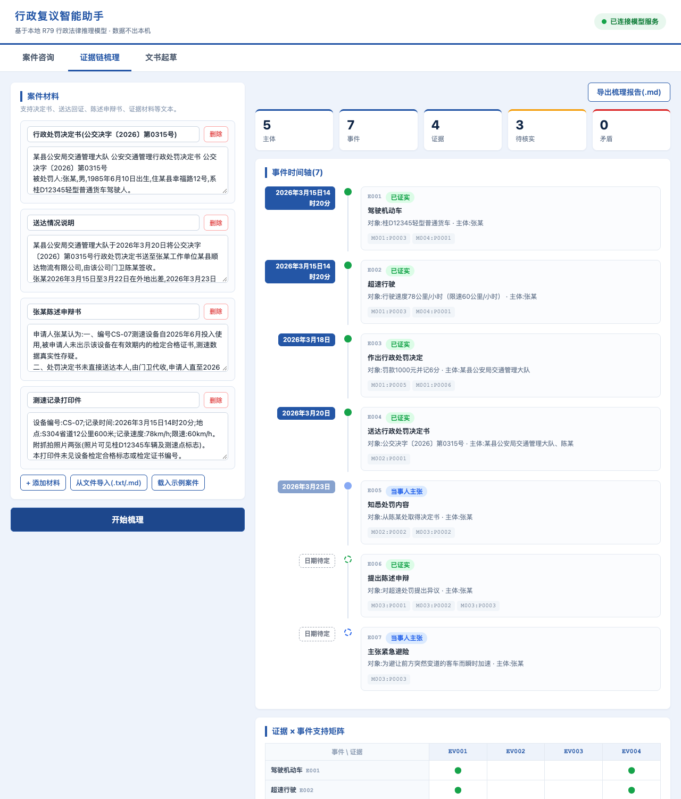
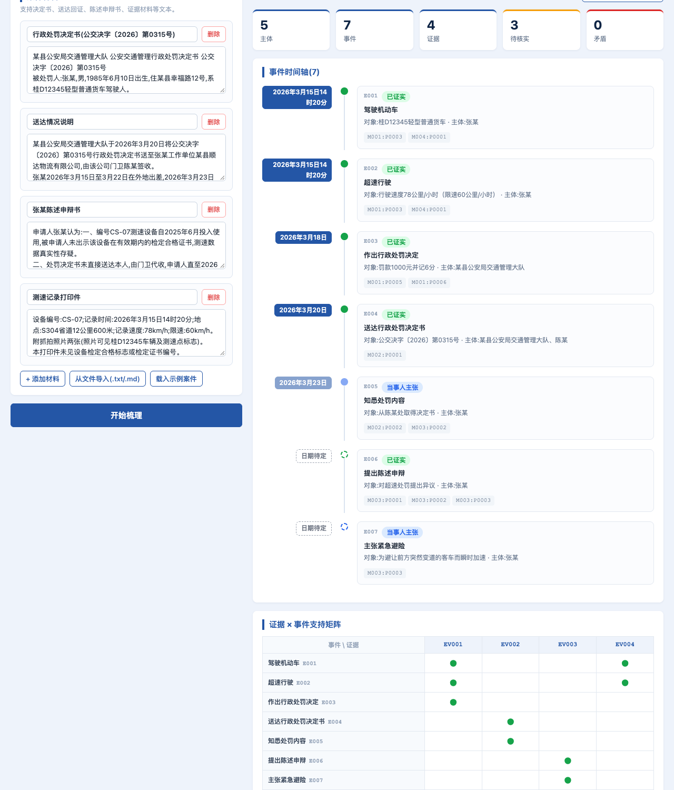
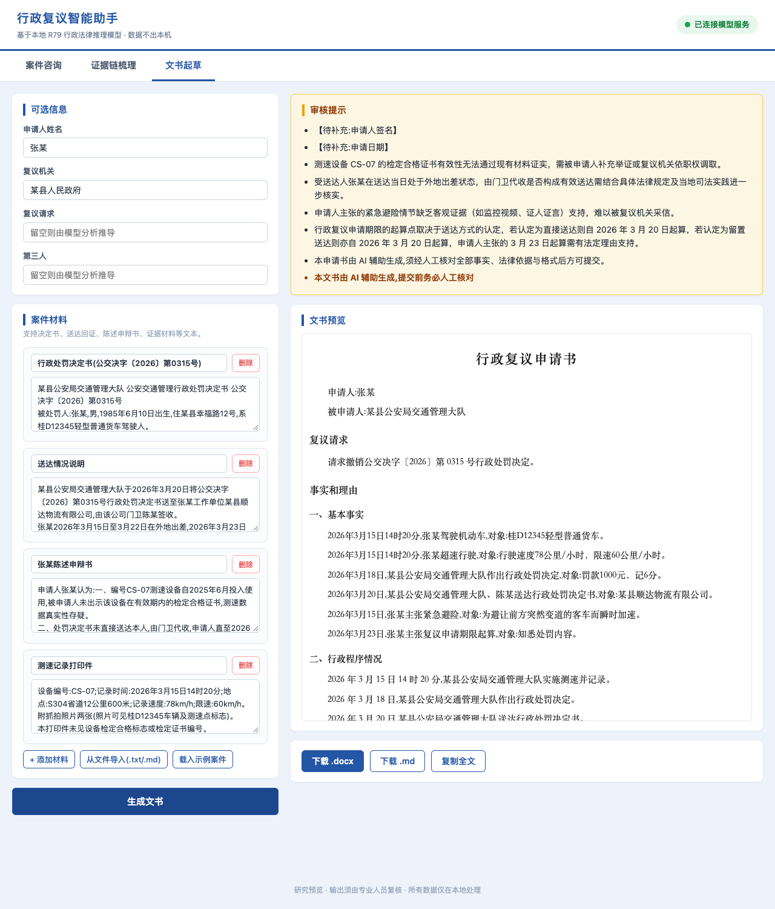
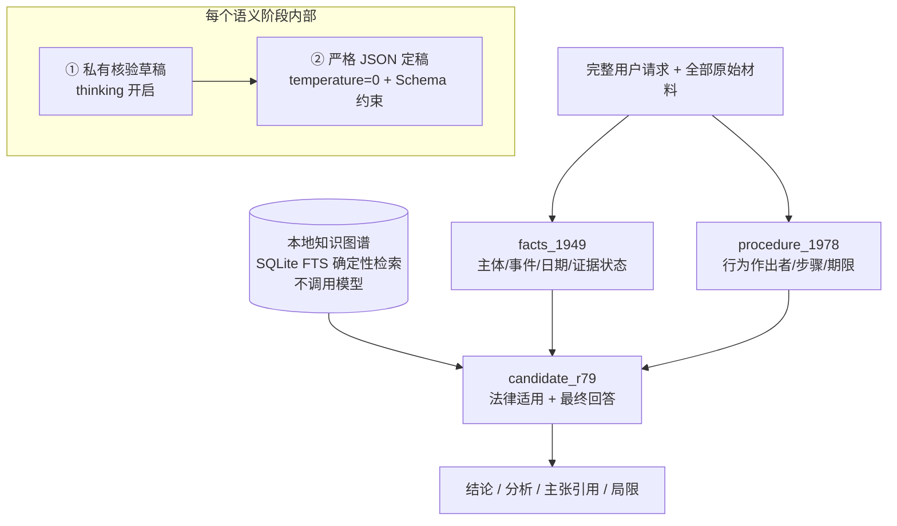
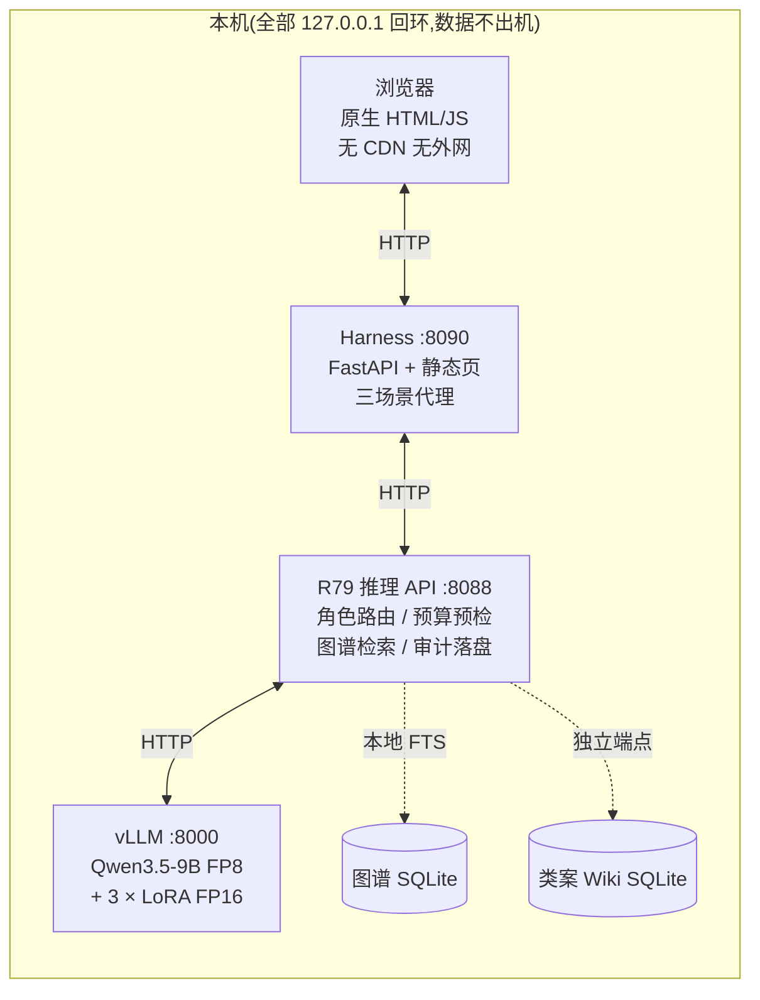

<div align="center">

# 行政复议智能助手

**自主微调的行政法律推理模型 + 本地 Web 壳(harness),数据不出本机**

[](LICENSE)
[](https://www.python.org)
[](https://github.com/vllm-project/vllm)
[](https://huggingface.co/xujianing1990/qwen3.5-9b-fp8-1949-1978-r79-public)
[](#数据安全与合规)

</div>

---

## 这是什么

一个**可审计、可本地运行**的行政复议案件智能办理系统，由两部分组成：

| 组成部分 | 内容 | 一句话说明 |
| --- | --- | --- |
| 🧠 **推理模型** | `src/` · `scripts/` · `docs/` | 自主微调的 Qwen3.5-9B + 三个任务 LoRA 适配器，按角色显式路由，两段式有界生成，逐段引用可回查 |
| 🖥️ **Harness(Web 壳)** | `harness/` | 把推理 API 包装成中文浏览器界面：案件咨询、证据链梳理、复议文书起草，一键导出 docx |

> ⚠️ 这是研究预览，不是法律意见、专家金标或生产质量承诺。所有输出必须由合格人员复核。

## 界面速览（真实推理截图）

<table>
<tr>
<td width="50%"><br/><b>① 案件咨询</b> — 录入材料与问题</td>
<td width="50%"><br/><b>结论与主张</b> — 每条带证据状态与段落引用</td>
</tr>
<tr>
<td width="50%"><br/><b>② 证据链梳理</b> — 事件时间轴</td>
<td width="50%"><br/><b>证据 × 事件支持矩阵</b></td>
</tr>
<tr>
<td colspan="2" align="center"><br/><b>③ 复议文书起草</b> — 公文版式预览，一键导出 docx</td>
</tr>
</table>

---

# 第一部分：模型与推理框架（微调成果）

## 微调成果：一个基模，三个任务适配器

以 Qwen3.5-9B 为基模（FP8_DYNAMIC 量化，MTP 等关键张量保留 BF16)，针对行政复议办理的三个语义角色**分别微调了三个独立 FP16 LoRA 适配器**，推理时按任务显式路由，互不串扰：

| 适配器 | 职责 | 输出 |
| --- | --- | --- |
| `facts_1949` | 事实与证据整理 | 主体 / 事件 / 日期 / 证据状态，逐条绑定原文段落 |
| `procedure_1978` | 程序与时序审查 | 行为作出者 / 程序步骤 / 期限，锁定被复议行为 |
| `candidate_r79` | 法律适用与定稿 | 结论 + 分析 + 主张（带引用）+ 局限说明 |

退役适配器 `2008` 与未纳入的 `2026` **明确排除**，路由表固定，绝不选择未声明的适配器。

## 推理流程：两段式有界生成



- **每次生成前**调用后端 tokenizer 做真实上下文预算检查，超限**明确拒绝而非截断**原文；
- 一次完整工作流固定 **6 次生成请求 + 6 次 tokenizer 预检**，进程级信号量限制后端并发 ≤ 8;
- 所有结构化输出经本地 JSON Schema 二次校验，引用未知段落或图节点**直接失败（fail closed)**。

## 证据纪律（为什么可信）

- 原始材料逐段保留，`M001:P0003` 式不可变引用 + SHA-256 绑定，任何主张可回查到段落；
- 缺失或 OCR 残缺的日期、号码、身份**必须保持未知**，严禁补写；
- 当事人主张与已证明事实严格分离，申请人 / 被申请人 / 作出机关 / 送达人 / 第三人角色不混淆；
- 图谱节点只是抽象条件，不是本案事实；必要前提未知即阻断下游结论。

## 评测（如实披露）

320 道已暴露题目、47 个来源簇的配对盲评（图谱增强 A/B):

| 指标 | 基线 | +图谱 | 变化 |
| --- | ---: | ---: | ---: |
| 整题正确率 | 51.56% | **67.19%** | **+15.6 pp** |
| 核心正确率 | 90.94% | 92.81% | +1.9 pp |
| 平均分 | 3.26 | 3.49 | +0.23 |

47 簇 bootstrap 区间不包含 0,6 项预注册门槛通过 4 项；因 5 份图谱回答终止性无效、严重错误题数上升，总体结论如实记为 `IMPROVEMENT_NOT_DEMONSTRATED`——图谱增益有效但尚未达到生产安全线，故公开运行时**保持图谱显式、本地、可审计**，不做自动部署声明。详见 [docs/EVALUATION.md](docs/EVALUATION.md)。

---

# 第二部分：Harness(Web 壳)

`harness/` 不改、不包装、不代理模型权重，只把本地推理 API 包装成**中文浏览器界面**，覆盖行政复议办理三个高频场景：

## ① 案件咨询

录入材料并提出问题（如"该处罚决定是否合法？复议期限从何时起算")，返回结构化结论、逐条分析、带证据状态与段落引用的主张列表和局限说明。可选"同时检索类案"——类案 Wiki 是**独立只读端点**，返回最相关的一份完整原文，**不注入推理**。

## ② 证据链梳理

一键把卷宗整理为可核验视图：主体表、按日期排序的**事件时间轴**、**证据 × 事件支持矩阵**、程序步骤与期限、矛盾与未知清单，附统计概览；全部条目带 `M001:P0003` 来源锚点，支持一键导出 Markdown 梳理报告。

## ③ 复议文书起草

文书 = **模型结构化分析 + 确定性模板组装**（不再调用模型自由生成）:《行政复议申请书》按申请人、被申请人、复议请求、事实和理由、证据目录、此致复议机关依次成文；缺失信息一律标注【待补充】并生成审核提示清单。支持在线预览、复制全文，导出**公文版式 docx**（标题二号方正小标宋/黑体居中，正文三号仿宋、首行缩进 2 字符、1.5 倍行距）。

## 演示模式（无 GPU 也能完整体验）

```bash
cd harness
HARNESS_MOCK=1 ./run.sh
```

内置合成示例案件（全部虚构），返回与真实接口结构完全一致的样例数据，页头显示黄色"演示模式"徽标，方便评审与测试。

---

# 配合使用：整体架构与安装



| 层 | 端口 | 职责 |
| --- | --- | --- |
| Harness | 8090 | 三标签页中文界面，透传健康状态 |
| R79 API | 8088 | 路由 / 两段式生成 / 预算检查 / 审计 |
| vLLM | 8000 | 基模 + 三适配器推理 |

## 安装路径 A:NVIDIA GPU 整栈（参评性能基准）

要求：Python 3.11+、Linux/WSL2、支持当前 vLLM 的 NVIDIA GPU（已验证 vLLM 0.27.1 + MTP3 + FP8 + 三个 FP16 LoRA)。

```bash
git clone https://github.com/consciousHALU/qwen35-r79-legal-reasoning.git
cd qwen35-r79-legal-reasoning
python -m venv .venv && source .venv/bin/activate
pip install -e . && pip install -r requirements-backend.txt

# 模型需邀请码并经 Hugging Face 审批,见 docs/MODEL_ACCESS.md
r79-legal download-model

bash scripts/start_backend.sh   # 终端 1:vLLM(8000)
bash scripts/start_api.sh       # 终端 2:R79 API(8088)

cd harness && pip install -r requirements.txt
./run.sh                        # 终端 3:Harness(8090)
```

打开 `http://127.0.0.1:8090`，页头徽标为**绿色「已连接模型服务」**即整栈就绪。也可用 `bash scripts/bootstrap.sh` 一次完成依赖与模型下载；Windows 用 `bootstrap.ps1` / `run.ps1`。

## 安装路径 B:Mac(Apple Silicon）本地适配

无 NVIDIA GPU 时用 vllm-metal(MLX 后端）跑通**完整推理链路**（不加载 LoRA，三路由名经别名指向同一基模，输出为未微调基模水平，用于流程验证与演示）:

```bash
# 终端 1:vllm-metal 以四个别名服务同一基模
vllm serve --model <mlx-模型路径> \
  --served-model-name qwen3.5-9b facts_1949 procedure_1978 candidate_r79 \
  --max-model-len 32768 --mamba-ssm-cache-dtype float32 \
  --reasoning-parser qwen3 \
  --default-chat-template-kwargs '{"enable_thinking": false}' \
  --host 127.0.0.1 --port 8000

# 终端 2:R79 API + Harness 一条命令
bash scripts/start_local_mac.sh
```

适配全部由环境变量完成，**不改变默认（NVIDIA）行为**:

| 变量 | Mac 值 | 默认 | 原因 |
| --- | --- | --- | --- |
| `R79_DRAFT_THINKING` | `0` | `1` | 未加载适配器的基模思考不收敛，关闭后草稿直接输出核验清单 |
| `R79_MAX_MODEL_LEN` | `32768` | `16384`（取 routes.json) | 与本机 vllm-metal 实际上下文对齐 |
| `R79_REASONING_BUDGET` / `R79_FINAL_BUDGET` | `8192` / `6144` | `8192` / `8192` | 按 MLX 吞吐（约 40 tok/s）控制时延 |
| `HARNESS_REQUEST_TIMEOUT` | `2400` | `660` | Mac 完整工作流约 2-6 分钟 |

## 安装路径 C：纯演示（5 分钟上手，无需模型）

```bash
cd harness
pip install -r requirements.txt
HARNESS_MOCK=1 ./run.sh    # 打开 http://127.0.0.1:8090
```

## 验证

```bash
curl http://127.0.0.1:8088/health     # status=ok 且 graph_verified=true
pytest                                # 框架单元测试(11 项)
cd harness && HARNESS_MOCK=1 pytest   # harness 契约测试(11 项)
```

## 目录结构

```text
├── src/r79_legal_reasoning/   # 推理框架:路由 / 两段式客户端 / 图谱 / Wiki / 审计
├── scripts/                   # 启动与引导脚本(NVIDIA / Mac / Windows)
├── harness/                   # Web 壳:三大场景 + 演示模式 + 契约测试
├── data/  docs/               # 公开图谱数据与各专题文档
└── tests/                     # 单元与集成测试
```

---

## 数据安全与合规

- **只绑定回环**:8090 / 8088 / 8000 均只监听 `127.0.0.1`，案件材料不出本机；
- **无外发通道**：前端不依赖任何 CDN / 外网资源；
- **审计最小化**：默认 `hashes` 模式只落盘请求/响应哈希、路由、token 与状态，不保存原始材料与私有草稿；`R79_AUDIT_MODE=full` 需显式开启且 API 永不返回其内容；
- **检索隔离**：类案 Wiki 与推理端点严格分离，检索结果不自动进入模型上下文；
- **人工复核**：页面与文书均带"AI 辅助生成，须经人工核对"提示。

## 数据边界

仓库附带 1,030 条仅含抽象条件、规则与推导关系的公开图谱（内部案件身份与 provenance 已剥离）。原内部 Wiki 的 4,382 份全文材料因含个人信息且无再分发许可清单，**未上传公开仓库**；仓库提供同一检索接口、合成演示数据与本地索引构建器，导入自有语料前须完成隐私审阅并确认再分发权利，见 [docs/DATA.md](docs/DATA.md)。

## 文档索引

| 文档 | 内容 |
| --- | --- |
| [docs/ARCHITECTURE.md](docs/ARCHITECTURE.md) | 组件、固定路由表、证据纪律 |
| [docs/EVALUATION.md](docs/EVALUATION.md) | 320 题配对盲评完整记录 |
| [docs/MODEL_ACCESS.md](docs/MODEL_ACCESS.md) | 模型权重邀请码申请步骤 |
| [docs/DATA.md](docs/DATA.md) | 数据边界与 Wiki 语料规则 |
| [docs/COMPATIBILITY.md](docs/COMPATIBILITY.md) | 实际后端兼容记录 |
| [harness/README.md](harness/README.md) | Harness 配置项与契约测试说明 |
| [harness/docs/使用说明.md](harness/docs/使用说明.md) | 面向最终用户的操作手册 |

## 许可证

代码与随仓抽象图谱按 Apache-2.0 发布。模型仓库沿用 Qwen3.5 的 Apache-2.0 许可与模型卡限制。你导入的 Wiki 语料仍受其各自来源、隐私和再分发条件约束。